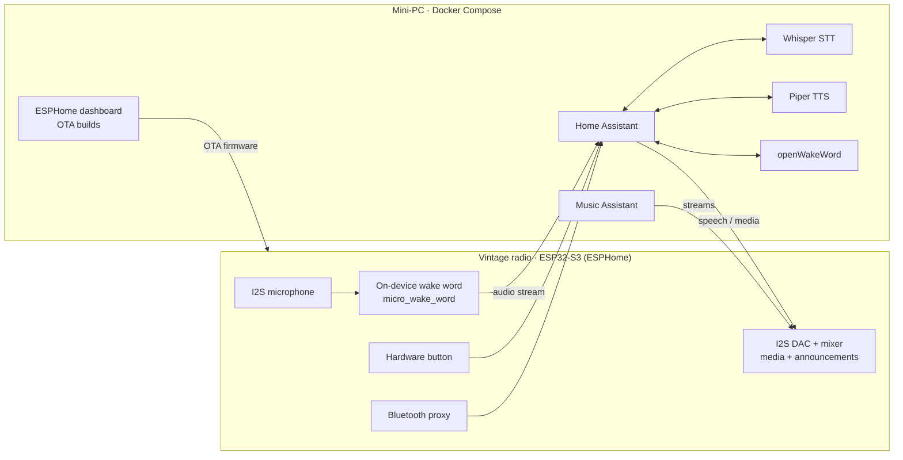

# Smart Home Infrastructure

<p>
  
  
  
  
</p>

Local-first smart home server described as code: **Home Assistant**, **ESPHome**, a fully local voice assistant pipeline (wake word → speech-to-text → LLM conversation → text-to-speech) and **Music Assistant** — one `docker compose up -d` away on any mini-PC.

The centrepiece is a **vintage radio retrofitted with an ESP32-S3**: it works as a network speaker, a wake-word voice satellite ("Hey Jarvis") and a Bluetooth proxy for the rest of the house.

## Architecture



## Services

| Service | Image | Port | Role |
|---|---|---|---|
| `homeassistant` | `home-assistant:stable` | 8123 | Core automation platform |
| `esphome` | `esphome/esphome` | 6052 | Builds and flashes ESP32 firmware over the air |
| `whisper` | `rhasspy/wyoming-whisper` | 10300 | Local speech-to-text (`tiny-int8`) |
| `piper` | `rhasspy/wyoming-piper` | 10200 | Local text-to-speech |
| `openwakeword` | `rhasspy/wyoming-openwakeword` | 10400 | Server-side wake word detection |
| `music-assistant` | `music-assistant/server` | 8095 / 8097 | Multi-room media streaming |

## What it does

- **Voice satellite** — the ESP32-S3 detects "Hey Jarvis" on-device, streams audio to Home Assistant and plays answers through an audio mixer, so announcements can interrupt music without stopping it.
- **AI briefing button** — a physical button sends a configurable prompt to the conversation agent and reads the answer aloud on the radio.
- **Presence-based greeting** — network presence tracking (phone ping) triggers a welcome message when someone comes home.
- **Bluetooth proxy** — the radio extends Home Assistant's BLE range; scan parameters are tuned to avoid starving Wi-Fi.
- **Infrastructure as code** — all configuration is versioned; secrets and heavy model/media data stay out of Git.

## Getting started

```bash
git clone https://github.com/RuslanBaatyrbekov/smart-home-infrastructure.git
cd smart-home-infrastructure

cp ha_config/secrets.example.yaml ha_config/secrets.yaml
cp esphome_config/secrets.example.yaml esphome_config/secrets.yaml
# fill in Wi-Fi credentials, static IPs, entity ids and prompts

docker compose up -d
```

Then open Home Assistant at `http://<host>:8123`, add the Wyoming integrations (Whisper, Piper, openWakeWord) and build the voice pipeline. Flash the radio once over USB from the ESPHome dashboard (`:6052`); later updates go over the air.

## Repository layout

```
docker-compose.yml          all services
ha_config/                  Home Assistant config, automations, blueprints
esphome_config/             ESPHome node definitions (vintage-audio.yaml)
*_data/, wyoming/           model and media volumes (git-ignored)
```

## Moving to a new server or router

1. Clone the repository on the new host and recreate both `secrets.yaml` files from the examples.
2. Give the tracked phone a static DHCP reservation matching `tracked_phone_ping_sensor`'s IP.
3. `docker compose up -d`, then update the ESPHome nodes from the dashboard — they rebuild with the new credentials.

## License

MIT
